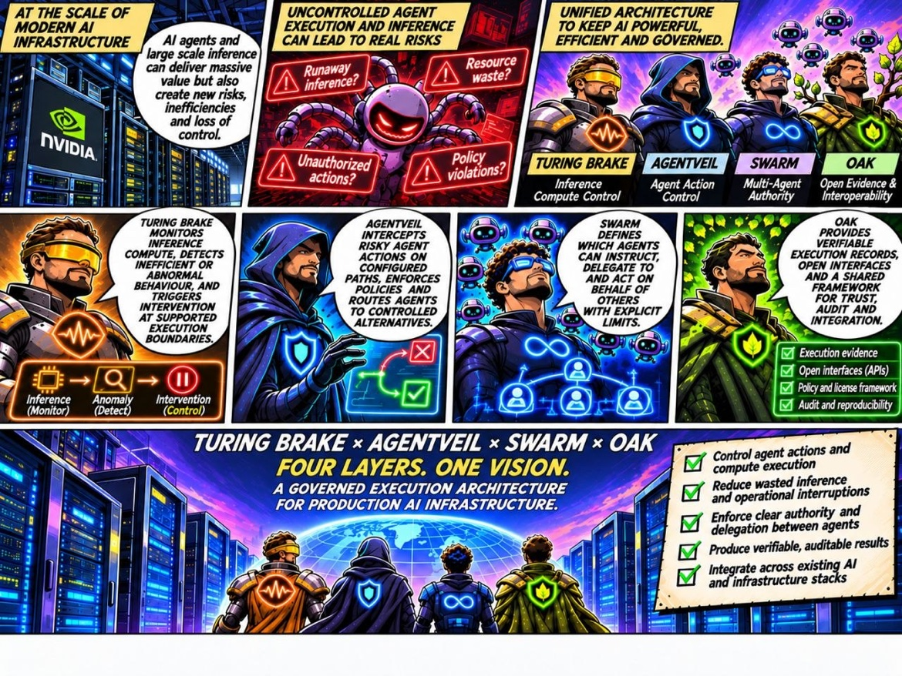

# Genesis AI Research Prime

The root office of Genesis AI Research — keeper of the charter and the public licence register.

## The rooms

- [charter](https://github.com/genesis-ai-research-prime/charter) — where the charter will live, when it is adopted
- [licence-register](https://github.com/genesis-ai-research-prime/licence-register) — every grant, on the record
- [benchmarks](https://github.com/genesis-ai-research-prime/benchmarks) — certification, as it is earned
- [oak](https://github.com/genesis-ai-research-prime/oak) — the open layer
- [demos](https://github.com/genesis-ai-research-prime/demos) — proof you can run

## The co-investigators' work

**SWARM** — Raeli Savitt
- Framework: [swarm-ai-research/swarm](https://github.com/swarm-ai-research/swarm)
- GitHub: [rsavitt](https://github.com/rsavitt)
- Paper: Aiersilan & Savitt, "Soft-Label Governance for Distributional Safety in Multi-Agent Systems", Proceedings of the 2026 AAAI Fall Symposium Series — [doi.org/10.1609/aaaiss.v10i1.43409](https://doi.org/10.1609/aaaiss.v10i1.43409)

**AgentVeil Protocol** — Oleg Boiko
- Organisation: [agentveil-protocol](https://github.com/agentveil-protocol)
- SDK: [agentveil-protocol/agentveil-sdk](https://github.com/agentveil-protocol/agentveil-sdk)

## Standing on shoulders

- James Clerk Maxwell, ["On Governors"](https://doi.org/10.1098/rspl.1867.0055), Proceedings of the Royal Society of London, 1868 — the governor, first treated as mathematics.
- A. M. Turing, ["Intelligent Machinery"](https://turingarchive.kings.cam.ac.uk/unpublished-manuscripts-and-drafts-amtc/amt-c-11), report for the National Physical Laboratory, 1948 — pleasure and pain as the education of a machine. Genesis reads that signal at execution time.
- Rolf Landauer, ["Irreversibility and Heat Generation in the Computing Process"](https://doi.org/10.1147/rd.53.0183), IBM Journal of Research and Development, 1961 — information is physical; erasure pays for itself in heat.
